# E-commerce Sales & Customer Analytics — Olist (Brazil)

End-to-end analysis of **96,211 delivered orders (R$15.37M revenue, 93,104 customers)**
from a real Brazilian marketplace to find what drives revenue, who the customers are, and what hurts customer experience.

**Tools:** Python (pandas, NumPy, Matplotlib, Seaborn) · SQL (PostgreSQL) · Excel · Power BI · Jupyter

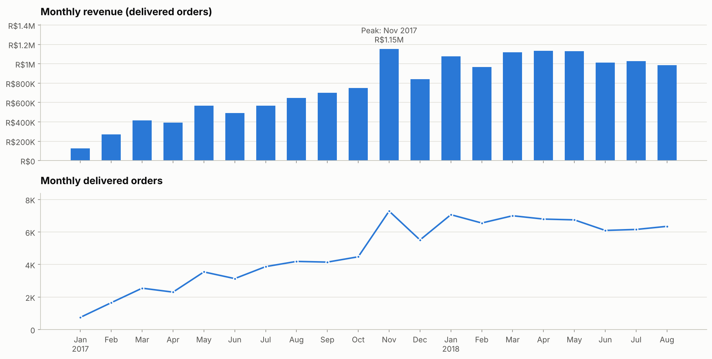

---

## Business problem

Olist connects small sellers to large online marketplaces. The commercial team wants to know **where revenue comes from,
which customers and regions matter most, and why some customers are unhappy**, so it can focus marketing, seller
management and logistics where they will have the most impact.

## Objectives

1. Measure revenue, orders, AOV, customers and repeat behaviour, and how they trend (monthly, weekly, year over year).
2. Find the best and worst categories, states and regions, and how concentrated revenue is.
3. Segment customers (RFM-style) and size each segment.
4. Quantify how delivery performance affects review scores.
5. Turn the findings into practical recommendations.

## Dataset

| | |
|---|---|
| Name | [Brazilian E-Commerce Public Dataset by Olist](https://www.kaggle.com/datasets/olistbr/brazilian-ecommerce) (Kaggle, publisher: Olist) |
| License | CC BY-NC-SA 4.0 (as listed on Kaggle) |
| Size | 8 CSV tables — 99,441 orders, 112,650 order items, 100,000 reviews, 96,096 unique customers, 32,951 products, 3,095 sellers |
| Period | Sep 2016 – Oct 2018 (analysis window: **Jan 2017 – Aug 2018**, the complete months) |
| Provenance | Downloaded 22 Oct 2026 from two GitHub mirrors of the Kaggle dataset and verified as identical (SHA-256) — see [`data/raw/SOURCE.md`](data/raw/SOURCE.md) |

**Not in the data:** product cost, commissions and marketing spend — so **profit cannot be calculated** and is not invented.

## Project architecture

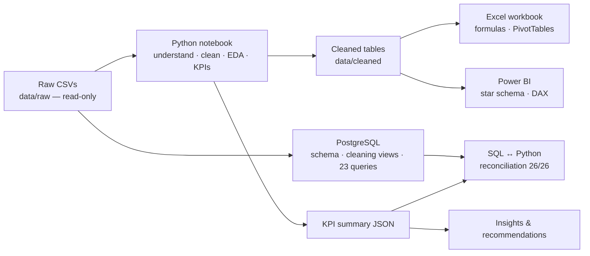

## Data cleaning (summary)

* Converted all timestamps; kept zip codes as text (leading zeros).
* **Real customer = `customer_unique_id`**, not `customer_id` (which changes every order) — otherwise repeat customers disappear.
* One review per order (kept the latest; 559 older duplicates removed).
* Filled 610 missing categories with "Unknown", added 2 missing English names, fixed 4 misspelled ones.
* Standardised 611 seller city spellings to 589.
* Flagged (not deleted) timestamp/status conflicts; restricted KPIs to the 20 complete months.
* Outliers (large orders) kept — they are real purchases; medians reported next to means.

Full details: [`docs/data_cleaning.md`](docs/data_cleaning.md) · log: [`reports/cleaning_log.csv`](reports/cleaning_log.csv)

## SQL analysis (PostgreSQL)

* [`sql/schema.sql`](sql/schema.sql) — tables, keys, indexes; [`sql/load_data.sql`](sql/load_data.sql) — loads the raw CSVs.
* [`sql/cleaning_views.sql`](sql/cleaning_views.sql) — the notebook's cleaning rules as views (`v_orders`, `v_delivered_orders`, `v_delivered_items`).
* [`sql/analysis_queries.sql`](sql/analysis_queries.sql) — **23 queries** from basics to advanced: JOIN / LEFT JOIN / anti-join,
  CASE WHEN, CTEs, subqueries, date functions, `LAG`, running totals, `RANK`, `DENSE_RANK`, `ROW_NUMBER`, `NTILE`,
  `PERCENTILE_CONT`, moving averages.
* [`sql/business_questions.md`](sql/business_questions.md) — the business question and the actual result of every query; outputs in [`sql/results/`](sql/results/).
* **Reconciliation:** [`scripts/reconcile_sql_python.py`](scripts/reconcile_sql_python.py) recomputes 26 KPIs in SQL and Python — **26/26 match** ([report](reports/sql_python_reconciliation.md)).

## Python analysis

[`notebooks/ecommerce_sales_customer_analysis.ipynb`](notebooks/ecommerce_sales_customer_analysis.ipynb) — executed end to end:
data understanding → missing values & duplicates → data-quality checks → cleaning (logged) → feature engineering →
descriptive statistics & outliers → EDA → KPIs → monthly/weekly/YoY trends → category, region, customer (RFM),
payment and seller segments → correlation → findings → recommendations. Charts are saved in [`reports/figures/`](reports/figures/).

## Excel workbook

[`excel/ecommerce_analysis.xlsx`](excel/ecommerce_analysis.xlsx) (23 MB) — cleaned data as Excel Tables plus analysis sheets built only with
live formulas: `SUMIFS`, `COUNTIFS`, `AVERAGEIFS`, `VLOOKUP` (exact and approximate), `INDEX/MATCH`, `XLOOKUP` (with fallback),
`IF/IFS`, `PERCENTILE.INC`, `RANK.EQ`, `LARGE`, `EDATE`, named ranges, conditional formatting, a category lookup tool,
charts and **native PivotTables**. The Summary sheet checks every Excel KPI against the Python result (✓/✗).
Verified by a full recalculation: **46/46 checks passed** ([report](reports/excel_verification.md)).

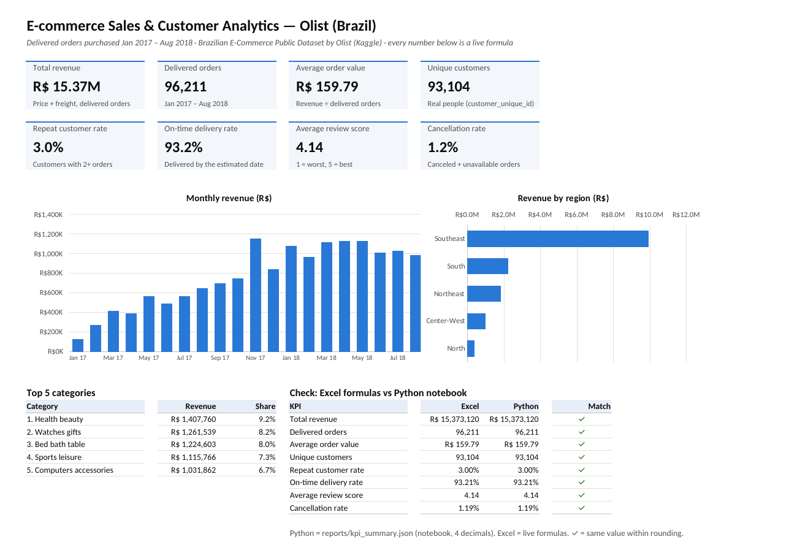
*Summary sheet of the workbook — rendered from the actual `.xlsx` file with LibreOffice.*

## Power BI dashboard

[`powerbi/Ecommerce_Olist.pbix`](powerbi/Ecommerce_Olist.pbix) — 3-page dashboard built in Power BI Desktop on a star schema
(orders and order-items facts; customer, state and date dimensions) with **39 DAX measures** (time intelligence, repeat rate, Top-N ranks):
**Executive Overview · Detailed Analysis · Business Insights**, with synced Year and Region slicers.
Model, refresh steps and expected values: [`powerbi/README.md`](powerbi/README.md).

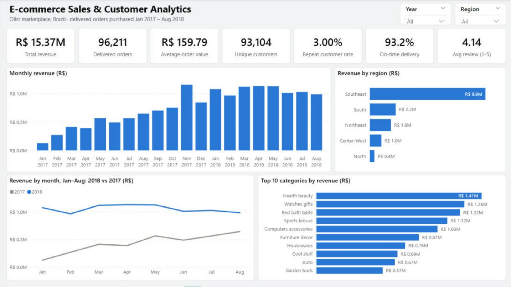

## KPIs (delivered orders, Jan 2017 – Aug 2018)

| KPI | Value | KPI | Value |
|---|---|---|---|
| Revenue | R$15.37M | Repeat customer rate | 3.0% |
| Delivered orders | 96,211 | On-time delivery rate | 93.2% |
| Average order value | R$159.79 (median R$105.28) | Avg delivery time | 12.5 days |
| Unique customers | 93,104 | Avg review score | 4.14 / 5 |
| Revenue per customer | R$165.12 | Cancellation rate | 1.19% |
| Freight share of revenue | 14.3% | YoY revenue growth (Jan–Aug) | +143.4% |

## Key insights

1. **Growth came from volume, not basket size:** Jan–Aug revenue +143.4% YoY, orders +139.9%, AOV only +1.4%.
2. **Black Friday 2017** was the best day (7.5× a median day).
3. **Customers rarely return:** repeat rate 3.0% — and for 30% of repeat customers the second order came on the same day as the first.
4. **18 of 74 categories = 80% of revenue**; top 3 = 25.3%.
5. **South-East = 64.6% of revenue** (SP alone 37.4%).
6. **North pays 18.5% freight vs 13.2% in the South-East and waits 22.6 vs 10.7 days.**
7. **Late delivery drives bad reviews:** 4.28★ on time vs 2.26★ late; 79% of 8+ day delays are rated 1–2★.
8. **North-East late rate 12.8%** vs 6.1% in the South-East (worst state MA 17.5%).

All 12 insights with business impact and actions: [`reports/insights.md`](reports/insights.md)

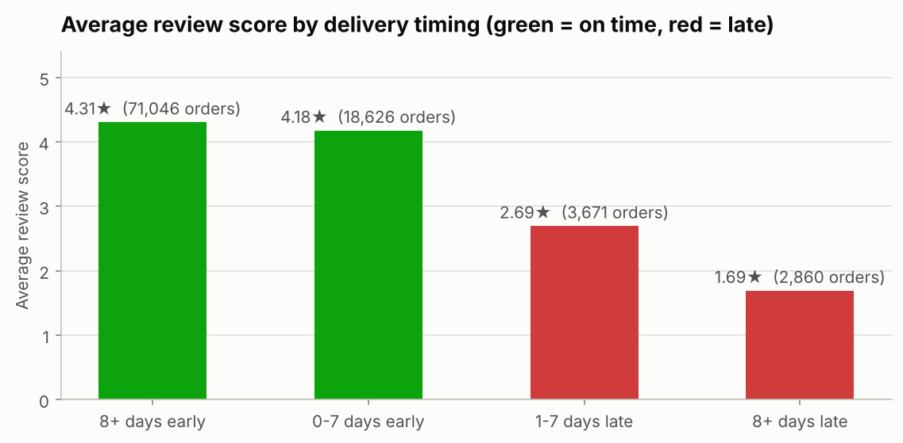

## Business recommendations

1. Retention programme for first-time buyers (post-delivery "buy again" offers) — repeat rate is only 3.0%.
2. Win-back campaign for 10,631 high-value lapsed customers.
3. Fix late deliveries in the North-East first (carrier review, realistic promised dates, proactive messages).
4. Test free-shipping thresholds / freight subsidies in the North and North-East.
5. Plan stock, sellers, carriers and support for Black Friday.
6. Protect the top categories and top sellers; use them for cross-selling.
7. Promote interest-free installments on higher-priced categories.
8. Collect cost data so the next version can measure profit.

## How to run

```bash
# 1. Python
pip install -r requirements.txt
jupyter notebook notebooks/ecommerce_sales_customer_analysis.ipynb   # Kernel → Restart & Run All

# 2. SQL (PostgreSQL 13+; run from the project root)
createdb olist_db
psql -d olist_db -f sql/schema.sql
psql -d olist_db -f sql/load_data.sql
psql -d olist_db -f sql/cleaning_views.sql
python scripts/run_sql_queries.py --db olist_db       # saves every result to sql/results/
python scripts/reconcile_sql_python.py               # SQL vs Python check

# 3. Excel: open excel/ecommerce_analysis.xlsx (Excel 2019 / 2021 / 365)
# 4. Power BI: open powerbi/Ecommerce_Olist.pbix (refresh steps in powerbi/README.md)
```

## Folder structure

```text
ecommerce-sales-customer-analytics/
├── README.md
├── requirements.txt
├── data/
│   ├── raw/            # 8 original CSVs (read-only) + SOURCE.md (provenance, checksums)
│   └── cleaned/        # fact_orders, fact_order_items, dim_customers, dim_state
├── notebooks/          # ecommerce_sales_customer_analysis.ipynb (executed)
├── sql/                # schema, load, cleaning views, 23 queries, business_questions.md, results/
├── excel/              # ecommerce_analysis.xlsx
├── powerbi/            # Ecommerce_Olist.pbix (3-page dashboard), measures.dax, power_query.m
├── reports/            # insights.md, kpi_summary.json, cleaning log, SQL reconciliation, Excel verification, figures/
├── docs/               # data_dictionary.md, data_cleaning.md, methodology.md
├── scripts/            # run_sql_queries.py, reconcile_sql_python.py
└── screenshots/        # Power BI pages + Excel Summary
```

## Screenshots

| | |
|---|---|
| 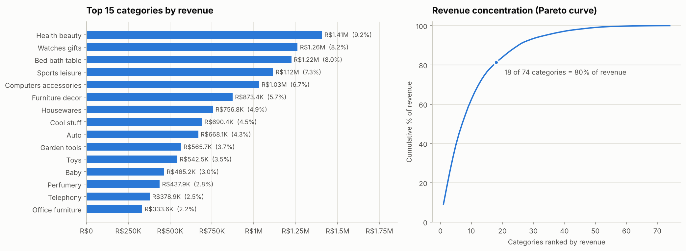 | 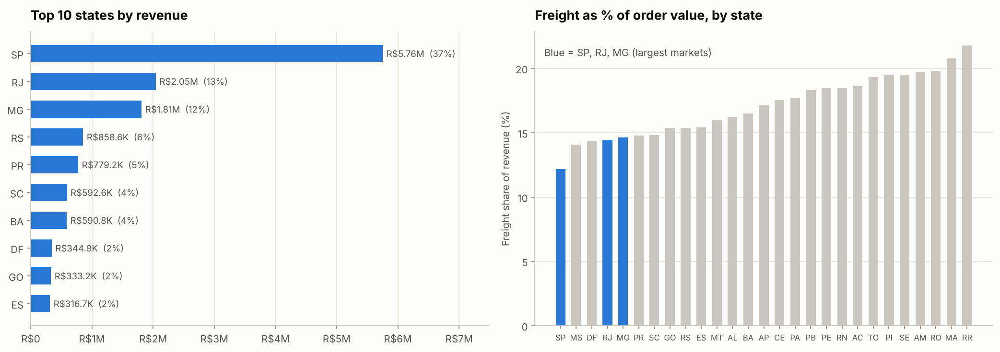 |
| 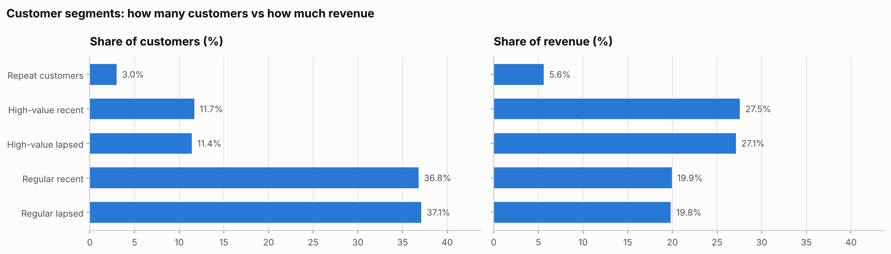 | 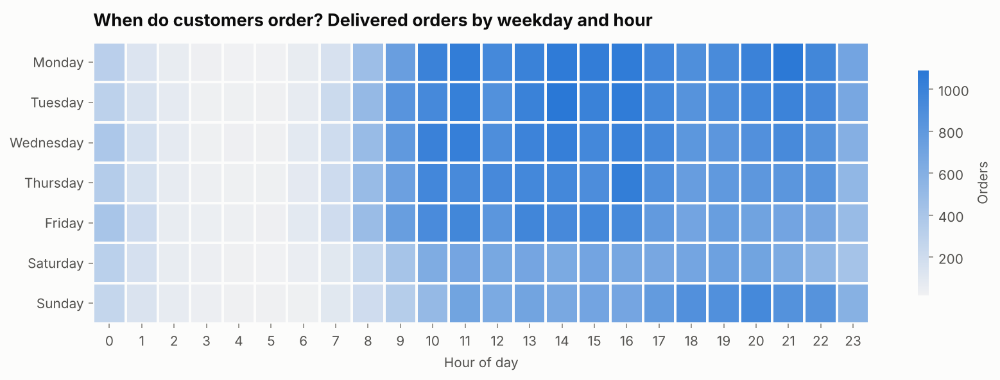 |
| 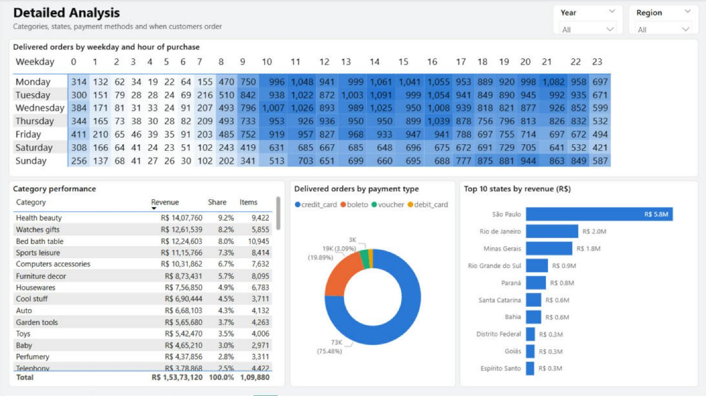 | 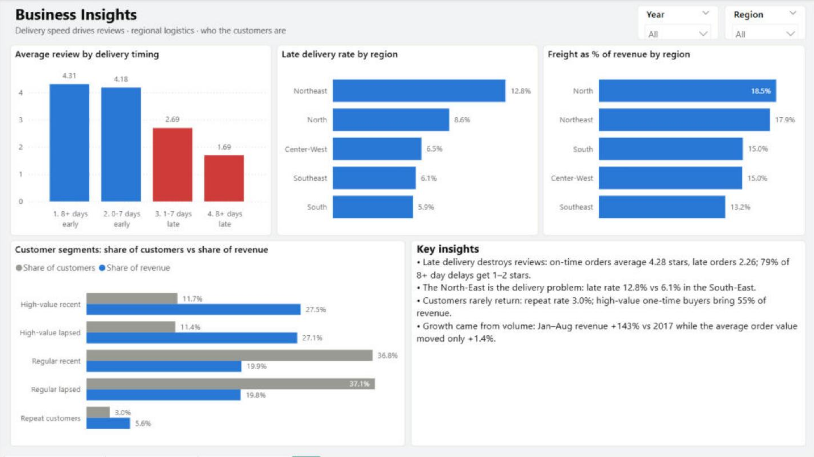 |

## Limitations

* No cost data → no profit or margin.
* Product names are anonymised (analysis by category / product ID only).
* One marketplace, one country, 2017–2018 — results describe Olist, not e-commerce in general.
* Correlations (e.g. late delivery ↔ low reviews, installments ↔ bigger baskets) are not proof of causation.
* A late-May 2018 dip in orders is visible in the data; the reason is not in the dataset (a nationwide truckers' strike
  is a possible explanation, treated only as a hypothesis).

## Future improvements

* Cohort retention analysis by first-purchase month.
* Predict late deliveries from seller location, category, weight and distance (geolocation table).
* Review-text analysis (Portuguese NLP) to find complaint themes.
* Add cost data to analyse margin by category and seller.

---
*Author: Jatin Gohel · Data: Olist (CC BY-NC-SA 4.0) · All numbers in this README are generated from `reports/kpi_summary.json` and `sql/results/`.*
